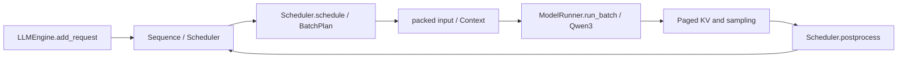

# Architecture and Code Guide

[中文](zh-CN/docs/ARCHITECTURE.md)

The inference implementation is in `nanovllm/`. Module paths in the table below are relative to that directory.

## Request execution

| Module | Responsibility |
| --- | --- |
| `engine/llmengine.py` | Public request entry point and execution loop; `LLM` inherits this engine |
| `engine/scheduler.py` | Three policies, token/sequence budgets, preemption, chunk progress, and post-step commits |
| `engine/batch.py` | `BatchEntry` / `BatchPlan` describe each request's query range and sampling eligibility for the iteration |
| `engine/input.py`, `engine/context.py` | Pack requests and maintain positions, query ranges, and cache context |
| `engine/model_runner.py` | Model forward pass, KV initialization, and mixed-batch execution |
| `engine/block_manager.py` | Physical blocks, references, prefix lookup, and cache allocation |
| `runtime/` | Paged KV tensor storage, reads, and attention computation |
| `models/`, `layers/`, `utils/loader.py` | Qwen3, primitive layers, and local weight loading |

## Mixed-scheduling invariants

Mixed allocates token and sequence slots to decoding first, then to prefill. Query tokens are concatenated into one forward pass, while each request retains its own history length and positions. Partial prefill commits only computed KV progress and must not sample prematurely. Recomputation preserves request history; cache progress must not be mistaken for newly generated tokens.

The token budget controls per-step work, while sequence slots and KV capacity control admission and residency. A smaller budget is not necessarily better overall: it can increase prefill fragmentation and delay a new request's first token.

## Experiment pipeline

`experiments/prepare.py` creates frozen inputs from the model and SPEED-Bench; `launch.py` generates arrivals and configurations; `run_matrix.py` assigns execution order using stable block IDs; `experiments/online/run_online.py` invokes the engine and records measurements; `experiments/analyze.py` computes paired summaries per configuration.

Execution blocks `0,3,4` correspond to S/I/M, I/M/S, and M/S/I, placing each policy first, second, and third once. These are three repeats, not six.

## Attribution limits

Serving results are consistent with decode priority, but the experiment does not independently isolate the contributions of a shared forward pass, scheduling priority, admission control, and preemption/recomputation. Throughput gains alone do not establish higher GPU utilization; attribution requires execution ablations with fixed scheduling plans or profiling.
