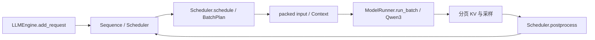

# 代码导览

推理实现位于 `nanovllm/`。下表中的模块路径均相对于该目录。

## 请求推进

| 模块 | 主要职责 |
| --- | --- |
| `engine/llmengine.py` | 公共请求入口和执行循环；`LLM` 继承该 Engine |
| `engine/scheduler.py` | 三策略、token/序列预算、抢占、分块推进与步后提交 |
| `engine/batch.py` | 用 `BatchEntry` / `BatchPlan` 描述一个请求本轮的查询区间和采样条件 |
| `engine/input.py`、`engine/context.py` | 将不同请求打包，维护位置、query 范围与缓存上下文 |
| `engine/model_runner.py` | 模型前向、KV 初始化及混合批执行 |
| `engine/block_manager.py` | 物理块、引用关系、前缀查找及缓存分配 |
| `runtime/` | 分页 KV 张量存储、读取与 attention 计算 |
| `models/`、`layers/`、`utils/loader.py` | Qwen3、基础层及本地权重加载 |

## mixed 的关键约束

mixed 为 Decode 优先分配 token 和序列名额，再安排 Prefill。查询 token 被拼接为一次前向，但每个请求仍有独立历史长度和位置。部分 Prefill 只提交已计算的 KV 进度，不能误采样；在需要重算时保留请求历史，不能把缓存进度误当作新生成 token。

token budget 控制单步工作量，序列名额与 KV 容量控制接纳和驻留。更小预算不一定全局更优：它也可能增加 Prefill 切分次数，延迟新请求首 token。

## 实验路径

`experiments/prepare.py` 从模型和 SPEED-Bench 生成冻结输入；`launch.py` 生成到达过程和各配置；`run_matrix.py` 按稳定 block ID 安排执行顺序；`experiments/online/run_online.py` 调用引擎并记录测量；`experiments/analyze.py` 逐配置配对汇总。

执行 block `0,3,4` 分别对应 S/I/M、I/M/S、M/S/I，使每种策略各处于一次第一、第二、第三执行位置。它们是三个重复，不是六个。

## 解释的边界

长输入在线实验的指标与 Decode 优先的机制一致，但实验并未独立分离一次合批前向、优先级、接纳控制和抢占重算的贡献。吞吐改善不能直接解释为 GPU 利用率提高；需要固定调度计划的执行消融或 profiling 才能进一步归因。
