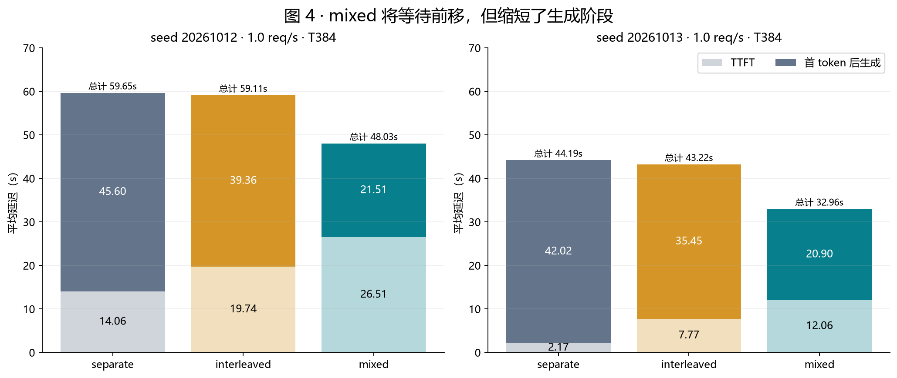

# Qwen3 推理引擎与混合批调度

[English](../../README.md)

参考 nano-vLLM 架构，使用 PyTorch 实现 Qwen3 推理引擎，扩展 Chunked Prefill、Prefill/Decode 混合批、分页 KV、前缀共享及抢占恢复，并通过受控突发请求与持续到达负载评估调度效果。

**主要结果：** 在 RTX 4090 / Qwen3-4B 的长输入回放中，Decode 优先的 mixed 调度缩短请求完成时间、改善生成连续性，高负载下也有吞吐收益；代价是新请求的首 token 等待增加。

## 从这里了解项目

| 想了解什么 | 阅读入口 |
| --- | --- |
| 我实现了哪些模块，如何配合执行？ | [架构与代码导览](docs/ARCHITECTURE.md) |
| 长输入在线负载中有什么收益和代价？ | [在线服务性能报告](reports/long_input_serving/README.md) · [Notebook](reports/long_input_serving/mixed_scheduling_report.ipynb) |
| 已有 Decode 遇到新 Prefill 时会怎样？ | [突发请求调度报告](reports/burst_requests/README.md) |
| 如何验证数据、重新运行实验？ | [复现指南](docs/REPRODUCE.md) · [验证记录](VALIDATION.md) |

## 工程实现

- **调度：** Prefill 优先（separate）、P/D 轮间交替（interleaved）、同轮混合（mixed）。mixed 先为 Decode 保留 token 与序列名额，再安排分块 Prefill。
- **执行：** 将不同请求的 Prefill 片段与 Decode token 打包为一维输入，在同一次模型前向中推进；维护查询区间、绝对位置和缓存长度，区分部分 Prefill 提交与采样。
- **缓存：** 分页 KV、链式哈希前缀共享与引用计数、容量不足时的抢占重算，以及分块续算和生成历史恢复。
- **验证：** Hugging Face 数值对拍、缓存边界和恢复测试，三策略回放、执行顺序轮换与配对统计。

当前使用 PyTorch 分页注意力和 greedy sampling；未实现完整上游的高性能 kernel、CUDA Graph、张量并行或 HTTP 服务。

## 代表性性能结果

配置：RTX 4090、Qwen3-4B / BF16、SPEED-Bench 约 2K 输入、固定输出 128 token、Poisson 到达率 1 req/s、token budget=384、max_seqs=16、关闭前缀缓存。表中每项为三个执行 block 的均值，基线为 Prefill 优先的 separate。

| 到达种子 | 输出吞吐 separate → mixed | 平均 E2E separate → mixed | 平均 TTFT separate → mixed |
| --- | --- | --- | --- |
| 20261012 | 78.26 → 84.61 token/s（+8.11%） | 59.65 → 48.03 s（−19.50%） | 14.06 → 26.51 s |
| 20261013 | 78.10 → 83.77 token/s（+7.27%） | 44.19 → 32.96 s（−25.40%） | 2.17 → 12.06 s |



完整在线服务实验覆盖三档到达率、两个到达种子、两档预算与三种策略，共 108 次正式回放。突发请求实验使用三个独立输入组、四档预算与三次重复，同样保留全部 108 次正式回放。

这些结果限于单模型、单 GPU、合成到达和固定输出长度。吞吐包含到达等待和末尾排空，不代表最大稳态容量；延迟不含网络开销。完整收益、负向结果和限制均保留在报告中。

## 项目结构

```text
nanovllm/                    推理引擎、调度、模型层与分页 KV
examples/generate.py         checkpoint 生成示例
tests/                       数值、缓存、调度和实验工具测试
experiments/                 统一的实验准备、执行、计时与统计工具
  metadata/                  重建样本划分所需的索引
  common/                    计时、回放与诊断
  online/                    请求到达与在线指标
  simulation/                CPU 调度模拟
reports/
  burst_requests/            突发请求调度报告
  long_input_serving/        长输入在线服务报告、Notebook 与图表
  data/                      全部正式测量及来源指纹
tools/                       数据核验与报告生成
docs/                        架构和复现说明
```

实验入口按功能组织，同一套代码通过模型路径和设备参数适配运行环境。

## 使用与复现

建议 Python 3.12；依赖以正式性能实验的 PyTorch 2.8.0 / Transformers 4.57.6 为参考。模型和数据集需自行准备，不包含在仓库内。

```bash
python -m pip install -r requirements.txt
python examples/generate.py /path/to/Qwen3-4B --dtype bfloat16 --device cuda
python -m pytest tests -q
```

只核验公开测量，不需要模型、GPU 或 PyTorch：

```bash
python tools/verify_results.py
```

重算报告：

```bash
python -m pip install -r requirements-report.txt
python tools/render_burst_report.py --language zh-CN
python tools/render_serving_report.py --language zh-CN
```

完整推理实验统一从 `python experiments/launch.py` 启动，具体配置见 [复现指南](docs/REPRODUCE.md)。

## 来源

架构参考 [nano-vLLM](https://github.com/GeeeekExplorer/nano-vllm)，保留其 [MIT 声明](../../licenses/nano-vllm-MIT.txt)。输入来自 [SPEED-Bench](https://huggingface.co/datasets/nvidia/SPEED-Bench)，数值参考使用 Hugging Face Qwen3。数据精简方式见 [公开数据说明](reports/data/README.md)，来源声明见 [THIRD_PARTY_NOTICES.md](THIRD_PARTY_NOTICES.md)。
