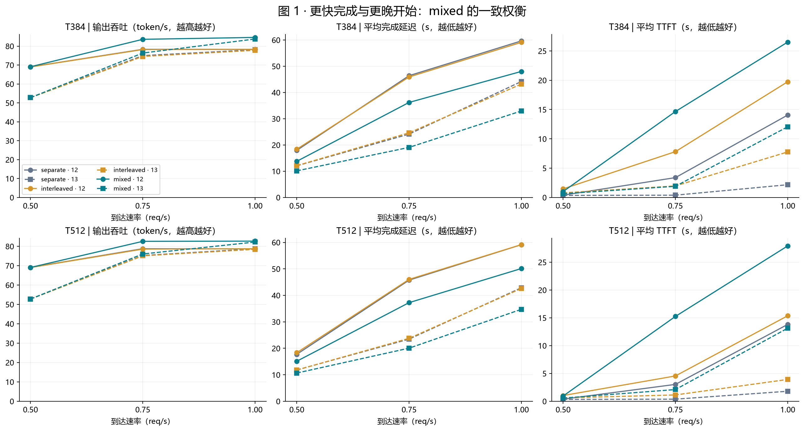
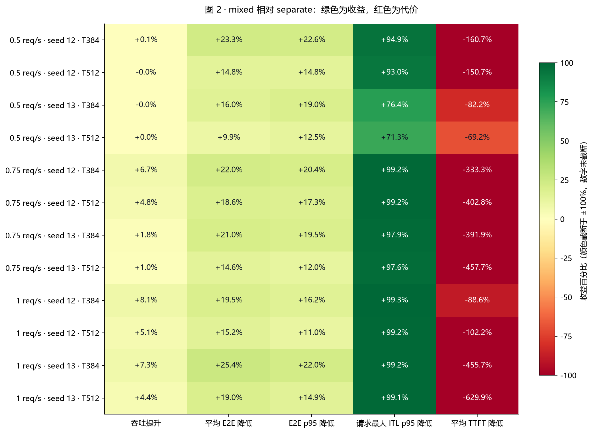
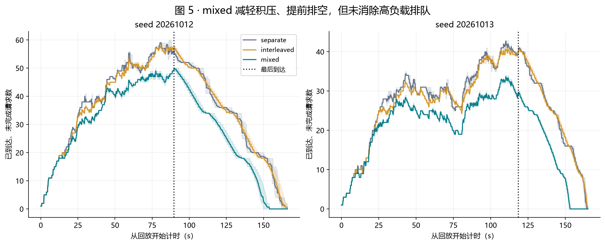

<!-- Generated by tools/render_serving_report.py from the executed notebook. -->

# Mixed 调度在长输入在线负载中的作用

[English](../../../../reports/long_input_serving/README.md)
## 长输入在线实验 · 两个到达种子 · 三个执行 block

**结论：mixed 的主要价值是减少开始输出后的长停顿、缩短请求完成时间；高负载下还有吞吐收益，但需要付出更长的首 token 等待。**

本报告仅使用已经完成的 长输入在线实验 数据，不新增推理实验。主要基线为 **separate**，interleaved 为辅助对照。所有计算由下方 Python 单元格从公开测量 JSON 完整重算，图像由 Matplotlib 生成。

> **证据边界**：这是同一套完整 SPEED-Bench 长文本上的合成 Poisson 到达实验，不是生产流量回放。所有配置均出现跨策略输出哈希不一致，因此性能观察不能直接扩展为“答案等价且全面更优”。

阅读顺序：数据核验 → 总体权衡 → 配对收益 → 生成停顿 → 延迟构成与积压 → 结论边界。

## 1. 数据来源与复现

数据目录：`reports/data/long_input_serving/formal`。

Notebook 已嵌入执行结果，打开即可阅读。重新运行时，在本仓库中使用项目 `.venv` Python 内核；需要 `numpy、matplotlib、IPython`。从当前目录向上自动寻找仓库，不依赖远程机绝对路径。代码仅读取结果并写出图像，不加载模型。

统计单位为一次完整回放。每个“速率 × 到达种子 × budget × 策略”有三个 block；100 条请求不被当作 100 次独立实验。

公开版保留全部逐请求测量及策略汇总；输入 token 序列仅保留长度和 SHA-256，重复的顶层 summary 已移除。此处能重算性能报告，不能直接用于推理回放。导出规则和原始文件指纹见 [数据说明](../data/README.md)。

| 核验项 | 结果 |
| --- | --- |
| 完整结果文件 / 正式回放 / 请求记录 | 36 / 108 / 10800 |
| 到达种子 / block | [20261012, 20261013] / [0, 3, 4] |
| 速率 / token budget | [0.5, 0.75, 1.0] req/s / 384、512 |
| 独立文本集合 / 输入长度 | 1 / 1941–2171 token |
| 文本类别 | {'high_entropy': 50, 'low_entropy': 50} |
| 模型 / GPU / dtype | /root/model/Qwen3-4B / NVIDIA GeForce RTX 4090 / bfloat16 |
| 每批最大序列数 / KV blocks / prefix cache | 16 / 565 / False |
| 源码 / 环境 / 模型指纹种类 | {'source_sha256': 1, 'environment': 1, 'checkpoint_files': 1} |
| 输出哈希跨策略不一致文件 | 36 / 36 |
| 重复、缺失组合、非有限核心指标、数值恒等式 | 全部检查通过；未删除异常记录 |

## 2. 吞吐、完成时间和首 token 的权衡

每条线代表一个策略；实线为种子 20261012，虚线为 20261013，点为三个 block 的均值。两个种子分开展示，不把到达流量差异隐藏在总平均里。

**阅读重点**：低速率时吞吐接近，仍然可能有完成延迟收益；高负载时 mixed 的吞吐提高，但首 token 等待也更长。这里的吞吐包含等待到达及末尾排空，不等于最大稳态容量。

## 3. 全部配置的配对收益

下图将收益统一为“正值更好”：吞吐使用 `(mixed / separate − 1) × 100%`；延迟使用 `(1 − mixed / separate) × 100%`。先对三个 block 求均值，再计算比值，不混合不同配置。

颜色区间固定在 ±100%，超出范围用深色封顶；**格内文字仍显示真实百分比**。TTFT 的大幅负值是代价，不能忽略。

| 指标 | mixed 胜出的配对数 | 配对差 95% t 区间完全位于有利方向的配置数 |
| --- | --- | --- |
| throughput | 30/36 | 9/12 |
| e2e | 36/36 | 12/12 |
| e2e95 | 36/36 | 12/12 |
| stall95 | 36/36 | 12/12 |
| ttft | 0/36 | 0/12 |

**解释**：平均 E2E、E2E p95 和请求最大 ITL 的 p95 在全部配对中改善；平均 TTFT 在全部配对中恶化。高负载吞吐收益跨 block 一致，低负载吞吐差异很小。

区间使用三个 block 的配对差、df=2，反映重复执行的波动。它们是探索性、未经多重比较校正的区间；不能将两种到达种子下的重复视为多个独立文本集合。

## 4. mixed 减少的是什么卡顿？

**普通 ITL p95** 对所有输出 token 间隔取分位数；**请求最大 ITL 的 p95** 则先找每个请求最慢的一次间隔，再对 100 个请求取 p95。后者突出少数很长的生成停顿，二者不可混用，也都不包含首 token 前的等待。

下图显示全部正式回放的点：每个“速率 × 策略”包含两个种子、三个 block，不绘制跨种子伪置信区间。左图采用对数坐标以同时展示毫秒级和秒级停顿。

高负载下，separate 的“请求最大 ITL 的 p95”达到数十秒，而 mixed 在这些回放中保持在数百毫秒量级。这支持“输出更连续”，不能表述为“整体响应快了 99%”。

低负载、无抢占的配置中同样能看到停顿改善，所以全部收益不能仅用“避免抢占”解释。

## 5. 首 token 更慢，为什么完成反而更快？

固定输出 128 token 时，每个请求满足：

$$\mathrm{E2E}=\mathrm{TTFT}+127\times\mathrm{TPOT}$$

这里选择共同的高负载 `1.0 req/s、T384`，同时展示两个种子；每根柱为三个 block 的均值。浅色为 TTFT，深色为首 token 后的生成时间。

以种子 20261012 为例：separate 平均 TTFT 为 14.06 s、后续生成 45.60 s；mixed 为 26.51 s 和 21.51 s，总完成时间从 59.65 s 降至 48.03 s。

代码中的 separate 优先 prefill；mixed 先安排 decode，再把剩余 token 和批次名额交给 prefill。这与“保护生成连续性、推迟新请求首 token”的现象一致。现有数据尚不能独立量化合批前向、调度优先级和资源占用各自的贡献。

## 6. 积压与资源行为

下面用逐请求时间戳重建“已到达但尚未完成”的请求数。它包含等待与正在运行的请求，**不是调度器 waiting 队列长度**。

固定 `1.0 req/s、T384`，两种子均展示三个 block 的范围（阴影）及均值（曲线）；虚线标记最后一次请求到达。

| 策略 | 全部正式回放中的抢占总次数 | 发生抢占的回放数 | mixed step 占比范围 |
| --- | --- | --- | --- |
| separate | 27 | 16 | 0.0%–0.0% |
| interleaved | 8 | 5 | 0.0%–0.0% |
| mixed | 0 | 0 | 11.1%–60.3% |

mixed 实际产生了 prefill/decode 合批，并且本次正式回放没有抢占。separate 与 interleaved 存在抢占，因此高负载性能差异同时包含调度、资源接纳和重算影响；不能将全部吞吐差异直接归因为 GPU 合批效率。

在本次数据中，mixed/T384 的平均 E2E 在六个“速率 × 种子”组合中均低于 mixed/T512，可作为当前配置下更偏向生成连续性的选择。它不是已经证明的全局最优预算，低负载下其 TTFT 也可能略差。

## 7. 全配置数值表与辅助基线

下表保留两个种子和两个 budget，不把它们混为一个总分。每项原始值都是三个 block 的均值，箭头为 separate → mixed。E2E 与 TTFT 单位为秒。

| 速率/种子/budget | 吞吐 tok/s | E2E s | TTFT s | 请求最大 ITL p95 ms | E2E 变化 | 吞吐比 |
| --- | --- | --- | --- | --- | --- | --- |
| 0.5/20261012/T384 | 69.05 → 69.09 | 17.95 → 13.77 | 0.39 → 1.01 | 3546.22 → 180.38 | -23.26% | 1.0006× |
| 0.5/20261012/T512 | 69.10 → 69.07 | 17.74 → 15.12 | 0.38 → 0.94 | 3138.54 → 219.17 | -14.76% | 0.9996× |
| 0.5/20261013/T384 | 52.79 → 52.78 | 12.06 → 10.14 | 0.35 → 0.63 | 722.62 → 170.89 | -15.96% | 0.9997× |
| 0.5/20261013/T512 | 52.78 → 52.78 | 11.83 → 10.66 | 0.34 → 0.57 | 696.86 → 199.80 | -9.87% | 1.0002× |
| 0.75/20261012/T384 | 78.32 → 83.61 | 46.41 → 36.21 | 3.38 → 14.66 | 30926.98 → 246.11 | -21.97% | 1.0675× |
| 0.75/20261012/T512 | 78.77 → 82.57 | 45.75 → 37.26 | 3.03 → 15.25 | 30778.63 → 247.88 | -18.57% | 1.0482× |
| 0.75/20261013/T384 | 74.99 → 76.35 | 24.14 → 19.08 | 0.39 → 1.90 | 10798.72 → 229.77 | -20.97% | 1.0182× |
| 0.75/20261013/T512 | 75.27 → 76.05 | 23.48 → 20.06 | 0.38 → 2.11 | 10512.34 → 248.46 | -14.55% | 1.0104× |
| 1/20261012/T384 | 78.26 → 84.61 | 59.65 → 48.03 | 14.06 → 26.51 | 32548.71 → 227.58 | -19.50% | 1.0811× |
| 1/20261012/T512 | 78.65 → 82.68 | 59.15 → 50.13 | 13.82 → 27.93 | 32189.78 → 270.37 | -15.24% | 1.0512× |
| 1/20261013/T384 | 78.10 → 83.77 | 44.19 → 32.96 | 2.17 → 12.06 | 29040.05 → 230.99 | -25.40% | 1.0727× |
| 1/20261013/T512 | 78.74 → 82.22 | 42.87 → 34.73 | 1.80 → 13.14 | 28663.22 → 254.87 | -18.99% | 1.0442× |

### 辅助对照：mixed 相对 interleaved（正值表示指标增加）

| 速率/种子/budget | 吞吐变化 | 平均 E2E 变化 | 平均 TTFT 变化 |
| --- | --- | --- | --- |
| 0.5/20261012/T384 | +0.15% | -25.03% | -31.02% |
| 0.5/20261012/T512 | +0.05% | -17.55% | -8.49% |
| 0.5/20261013/T384 | +0.04% | -16.40% | -19.18% |
| 0.5/20261013/T512 | +0.07% | -9.48% | -5.84% |
| 0.75/20261012/T384 | +6.92% | -21.15% | +87.57% |
| 0.75/20261012/T512 | +5.10% | -19.07% | +235.13% |
| 0.75/20261013/T384 | +2.41% | -22.55% | -3.10% |
| 0.75/20261013/T512 | +1.28% | -15.64% | +85.09% |
| 1/20261012/T384 | +8.10% | -18.75% | +34.28% |
| 1/20261012/T512 | +5.01% | -15.25% | +81.73% |
| 1/20261013/T384 | +7.69% | -23.73% | +55.29% |
| 1/20261013/T512 | +4.79% | -18.49% | +234.82% |

相对 interleaved，mixed 的平均 E2E 也在全部配对中改善，但 TTFT 收益不是普遍成立：低负载下通常改善，高负载下经常恶化。它进一步支持“完成速度与生成连续性”的定位，而非“所有延迟指标同时改善”。

## 8. 可以写入结论的发现与限制

**有数据支持的发现**

1. 在本次约 2K token 长输入、固定 128 token 输出的在线回放中，mixed 相对 separate 一致缩短了平均和 p95 完成延迟，并减少了生成长停顿。
2. 1.0 req/s 下，四个“种子 × budget”配置的吞吐提升约 4.42%–8.11%；低速率下吞吐基本不变，延迟仍有改善。
3. 收益伴随一致的 TTFT 代价。mixed 更适合重视生成连续性与总完成时间的目标；是否适合具体交互服务，需要结合首 token 的实际约束，当前没有预设 SLO，不能声称 SLO goodput 改善。
4. 两个种子、三个 block 的一致方向增强了本工作负载上的重复性证据，但没有扩大文本集合覆盖范围。

**必须保留的限制**

- 全部 36 个文件跨策略输出哈希不一致；同策略跨 block 也存在差异。哈希按请求 ID 排序计算，不是简单的完成顺序差异。可能涉及 BF16、批次变化或实现问题，现有记录不能确定原因；固定输出长度不代表输出质量等价。
- 同一套 100 条文本、固定长度输出、合成 Poisson 到达、单模型单 GPU：不能直接推广到更长上下文、不同输出分布或生产流量。
- 有限回放中的吞吐不是稳态容量，TTFT/ITL 不包含 HTTP 和网络开销。
- 未保存完整 step 细节和生成 token，不能单独归因 GPU 合批效率，也不能进行答案等价性诊断。

> **最终结论**：现有 长输入在线实验 结果已经展示了 mixed 在长输入在线调度中的性能作用：它通过优先推进已开始生成的请求，改善输出连续性和完成延迟，并在高负载下带来吞吐收益；同时延后新请求的首 token。该结论限于当前工作负载和实现，不能扩展为输出等价前提下的全面优势。

本报告到此仅解释已有结果，不启动或要求追加实验。

## 附录：原始记录定位

`rate0/1/2` 分别对应 `0.5/0.75/1.0 req/s`。每份文件包含三策略；引用指标时使用文件路径加 `runs` 中的策略名。

| 配置 | block | 原始记录 |
| --- | --- | --- |
| E_rate0_seed20261012_T384 | 0 | block0/E_rate0_seed20261012_T384/results.json |
| E_rate0_seed20261012_T512 | 0 | block0/E_rate0_seed20261012_T512/results.json |
| E_rate0_seed20261013_T384 | 0 | block0/E_rate0_seed20261013_T384/results.json |
| E_rate0_seed20261013_T512 | 0 | block0/E_rate0_seed20261013_T512/results.json |
| E_rate1_seed20261012_T384 | 0 | block0/E_rate1_seed20261012_T384/results.json |
| E_rate1_seed20261012_T512 | 0 | block0/E_rate1_seed20261012_T512/results.json |
| E_rate1_seed20261013_T384 | 0 | block0/E_rate1_seed20261013_T384/results.json |
| E_rate1_seed20261013_T512 | 0 | block0/E_rate1_seed20261013_T512/results.json |
| E_rate2_seed20261012_T384 | 0 | block0/E_rate2_seed20261012_T384/results.json |
| E_rate2_seed20261012_T512 | 0 | block0/E_rate2_seed20261012_T512/results.json |
| E_rate2_seed20261013_T384 | 0 | block0/E_rate2_seed20261013_T384/results.json |
| E_rate2_seed20261013_T512 | 0 | block0/E_rate2_seed20261013_T512/results.json |
| E_rate0_seed20261013_T512 | 3 | block3/E_rate0_seed20261013_T512/results.json |
| E_rate1_seed20261012_T384 | 3 | block3/E_rate1_seed20261012_T384/results.json |
| E_rate1_seed20261012_T512 | 3 | block3/E_rate1_seed20261012_T512/results.json |
| E_rate1_seed20261013_T384 | 3 | block3/E_rate1_seed20261013_T384/results.json |
| E_rate1_seed20261013_T512 | 3 | block3/E_rate1_seed20261013_T512/results.json |
| E_rate2_seed20261012_T384 | 3 | block3/E_rate2_seed20261012_T384/results.json |
| E_rate2_seed20261012_T512 | 3 | block3/E_rate2_seed20261012_T512/results.json |
| E_rate2_seed20261013_T384 | 3 | block3/E_rate2_seed20261013_T384/results.json |
| E_rate2_seed20261013_T512 | 3 | block3/E_rate2_seed20261013_T512/results.json |
| E_rate0_seed20261012_T384 | 3 | block3/E_rate0_seed20261012_T384/results.json |
| E_rate0_seed20261012_T512 | 3 | block3/E_rate0_seed20261012_T512/results.json |
| E_rate0_seed20261013_T384 | 3 | block3/E_rate0_seed20261013_T384/results.json |
| E_rate1_seed20261012_T384 | 4 | block4/E_rate1_seed20261012_T384/results.json |
| E_rate1_seed20261012_T512 | 4 | block4/E_rate1_seed20261012_T512/results.json |
| E_rate1_seed20261013_T384 | 4 | block4/E_rate1_seed20261013_T384/results.json |
| E_rate1_seed20261013_T512 | 4 | block4/E_rate1_seed20261013_T512/results.json |
| E_rate2_seed20261012_T384 | 4 | block4/E_rate2_seed20261012_T384/results.json |
| E_rate2_seed20261012_T512 | 4 | block4/E_rate2_seed20261012_T512/results.json |
| E_rate2_seed20261013_T384 | 4 | block4/E_rate2_seed20261013_T384/results.json |
| E_rate2_seed20261013_T512 | 4 | block4/E_rate2_seed20261013_T512/results.json |
| E_rate0_seed20261012_T384 | 4 | block4/E_rate0_seed20261012_T384/results.json |
| E_rate0_seed20261012_T512 | 4 | block4/E_rate0_seed20261012_T512/results.json |
| E_rate0_seed20261013_T384 | 4 | block4/E_rate0_seed20261013_T384/results.json |
| E_rate0_seed20261013_T512 | 4 | block4/E_rate0_seed20261013_T512/results.json |
